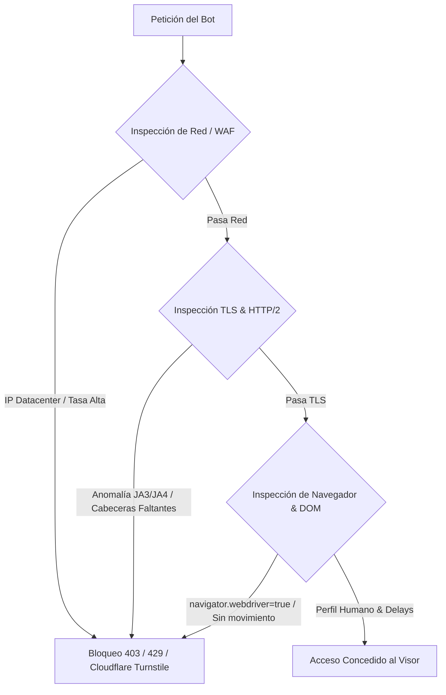
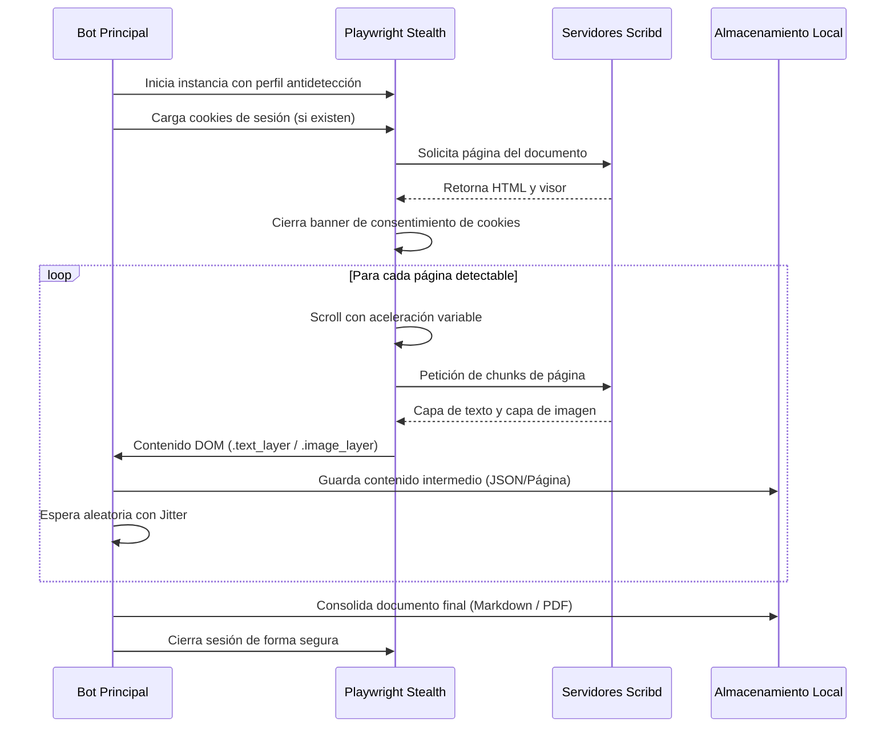

# Informe Técnico y Análisis Funcional: Desarrollo de Bot de Extracción en Scribd

**Documento Objetivo:** [GoAnywhere MFT User Guide 7.7.0](https://es.scribd.com/document/855660163/ga7-7-0-user-guide)  
**Lenguaje de Implementación:** Python 3.10+  
**Versión del Informe:** 1.0  
**Fecha:** Octubre 2026  

---

## 1. Resumen Ejecutivo y Objetivos

El objetivo de este proyecto es diseñar y planificar la arquitectura de un bot automatizado en **Python** para extraer la información contenida en la guía de usuario *GoAnywhere MFT 7.7.0* alojada en la plataforma Scribd.

Antes de proceder a la fase de codificación, este informe técnico analiza los siguientes aspectos críticos:
1. **Análisis Funcional y Estructural:** Cómo sirve Scribd sus documentos y cómo funciona su visor dinámico.
2. **Defensas y Detección de la Plataforma:** Factores que originan bloqueos de IP, CAPTCHAs y desafíos WAF.
3. **Reglas de Seguridad Antidetección:** Estrategias a nivel de red, navegador y comportamiento para evitar baneos o bloqueos.
4. **Arquitectura del Bot:** Módulos, dependencias, flujo de ejecución y manejo de fallos.
5. **Restricciones Críticas de Contenido (Paywall / Previsualización):** Viabilidad de extracción y requisitos de sesión.

---

## 2. Análisis Funcional de la Plataforma Objetivo (Scribd)

### 2.1. Anatomía del Visor de Documentos
Scribd no entrega un archivo PDF monolítico descargable mediante peticiones HTTP estáticas (`GET /document.pdf`). En su lugar, utiliza un visor web propietario tipo SPA (*Single Page Application*) optimizado para lectura y protección de derechos de autor.

Las características estructurales identificadas en el DOM son:
- **Contenedores de Página (`.outer_page`):** Cada página del documento se encapsula en un contenedor independiente con `contain: strict;`.
- **Carga Diferida (*Lazy Loading*):** Scribd no carga todas las páginas en memoria simultáneamente. Emplea `IntersectionObserver` para inyectar en el DOM únicamente las páginas que entran en el *viewport* del navegador (o adyacentes) y descarga las páginas que salen del rango visible.
- **Doble Capa de Representación:**
  - **Capa de Texto (`.text_layer`):** Contiene elementos `<span>` y `<div>` con coordenadas CSS absolutas (`transform: scale(0.2)`) que representan los caracteres y palabras para permitir la selección y búsqueda.
  - **Capa de Gráficos/Imágenes (`.image_layer`):** Contiene elementos `` con clase `.absimg` servidos desde CDNs como `html.scribdassets.com` o `imgv2-*.scribdassets.com`, que proveen fondos, diagramas y tipografía no vectorizada.

### 2.2. Modelo de Acceso y Navegación Completa: Sin Límite de 10 Páginas
A través de la verificación en la sesión activa del explorador (donde se ha navegado de forma continua **hasta la página 52 y más allá**), se constata que:
1. **Acceso al Documento Completo:** La plataforma **no impone un límite estricto de 10 páginas**. El documento puede recorrerse en su totalidad (hasta la página 127 o fin de documento) sin iniciar sesión.
2. **Controles Nativos de Paginación Identificados:**
   - **Botón de Página Siguiente:** Ubicado en la barra lateral izquierda (`button[aria-label*="siguiente"]` / `.IconButtonBase-module_large_hJBmho`). Permite avanzar de forma fluida página por página.
   - **Input de Salto Directo a Página:** `<input aria-label="Saltar a página" class="_1KN1Bc _22RkIJ" value="X" />`. Permite fijar directamente la página deseada y disparar el renderizado.
   - **Navegación por Teclado:** Emulación de teclas `PageDown` / `ArrowDown`.
3. **Gestión de Anuncios Intermedios:** Si en algún tramo de la navegación aparece un widget publicitario o de espera (*Ad-Gate*), este cuenta con botón de **"Omitir anuncio"** o temporizador breve de 5 segundos, el cual una vez superado permite continuar la navegación sin restricciones.
4. **Objetivo del Bot:** Automatizar el avance continuo por el botón de siguiente página / input de salto, capturando el 100% de las páginas del documento de principio a fin.

---

## 3. Mecanismos de Detección de la Plataforma (Causas de Bloqueo)

Scribd implementa capas de protección perimetral y en la aplicación (WAF como Cloudflare, Osano para gestión de consentimientos y análisis de comportamiento). Las solicitudes automatizadas son detectadas a través de:



1. **Huella TLS y HTTP/2 (JA3 / JA4 Fingerprinting):**
   - Librerías estándar como `requests`, `urllib` o `httpx` tienen firmas TLS distintas a las de navegadores reales (Chrome, Edge, Firefox). El WAF las bloquea de inmediato con códigos HTTP 403.
2. **Propiedades de Automatización en JavaScript:**
   - Motores de automatización como Selenium o Puppeteer sin configurar exponen banderas globales como `navigator.webdriver = true` o `window.cdc_adoQpoasnfa76pfcZLmcfl_Array`.
3. **Análisis de Frecuencia y Cadencia (Rate Limiting):**
   - Patrones de peticiones continuas, a intervalos idénticos y sin variación milimétrica disparan contramedidas por denegación de servicio o scraping.
4. **Ausencia de Interacción Humana:**
   - El visor de Scribd requiere eventos de scroll, renderizado de fuentes y pausas de lectura. La omisión de estos eventos impide la carga de las páginas diferidas.

---

## 4. Reglas de Seguridad y Evasión de Bloqueos

Para garantizar que el bot opere de manera estable y continua sin ser detectado ni penalizado, se definen las siguientes reglas técnicas de obligado cumplimiento:

### Regla 1: Emulación de Navegador Real mediante Playwright Stealth
* **Motor:** Utilizar `Playwright` con el plugin `playwright-stealth` o configuración manual de flags Chromium.
* **Flags requeridos al lanzar el navegador:**
  - `--disable-blink-features=AutomationControlled`: Oculta el flag nativo de WebDriver.
  - `--disable-features=IsolateOrigins,site-per-process`: Optimiza la interacción con frames si aplica.
  - Configuración explícita de `locale: 'es-ES'`, `timezone_id: 'America/Mexico_City'` (o local) y `viewport` dinámico estándar (ej. 1920x1080).

### Regla 2: Cabeceras HTTP Completas y Consistentes
* Configurar un `User-Agent` moderno correspondiente a la versión real de Chromium instalada.
* Suministrar el conjunto de cabeceras de cliente moderno (*Client Hints*):
  - `Sec-Ch-Ua`, `Sec-Ch-Ua-Mobile: ?0`, `Sec-Ch-Ua-Platform: "Windows"`.
  - `Sec-Fetch-Dest: document`, `Sec-Fetch-Mode: navigate`, `Sec-Fetch-Site: none`.
  - `Accept-Language: es-ES,es;q=0.9,en;q=0.8`.

### Regla 3: Tiempos de Espera con Variabilidad (Jittering)
* **Prohibido el uso de retardos fijos.** Cada pausa debe calcularse mediante una distribución aleatoria:
  $$\Delta t = t_{\text{base}} + \text{random}(0.8, 2.5)$$
* Pausas de scroll: entre **1.5 y 3.5 segundos** por cada bloque de página para permitir que los *assets* de Scribd respondan y rendericen las capas de texto.

### Regla 4: Scroll Progresivo con Simulación de Inercia
* En lugar de ejecutar saltos abruptos (`window.scrollTo(0, y)`), realizar desplazamientos incrementales fraccionados simulando la rueda del ratón (`mouse.wheel(0, deltaY)`).
* Permitir pausas de lectura ocasionales (3 a 5 segundos) cada 4 o 5 páginas para romper patrones periódicos.

### Regla 5: Gestión de Cookies y Soporte de Sesión Autenticada
* El bot debe incluir un mecanismo de importación/exportación de sesión (`storage_state.json`).
* Si el usuario dispone de una cuenta con acceso, las cookies de sesión se cargan antes de acceder al documento, permitiendo al bot visualizar el 100% de las páginas sin activar el paywall.
* Manejo automático del banner de consentimiento (Osano/Cookies GDPR) para evitar que bloquee la pantalla o los eventos de scroll.

### Regla 6: Control de Errores y Retroceso Exponencial (*Exponential Backoff*)
* Si se detecta un código HTTP 429 (*Too Many Requests*) o una pantalla de desafío:
  - Detener inmediatamente el proceso.
  - Aplicar un retroceso exponencial: esperar $2^n \times 10$ segundos antes de reintentar.
  - Si el bloqueo persiste, abortar y guardar el estado actual para no comprometer la dirección IP.

---

## 5. Arquitectura del Bot Propuesta

### 5.1. Stack Tecnológico
* **Lenguaje:** Python 3.10+
* **Motor de Automatización:** `playwright` (Python API)
* **Gestión Antidetección:** `playwright-stealth`
* **Parser de Datos:** `BeautifulSoup4` y `lxml` para estructuración de bloques de texto.
* **Procesamiento de Documentos:** `PyMuPDF` (`fitz`) o `fpdf2` para consolidar el texto e imágenes extraídas en un PDF reconstruido, o exportar a formato Markdown enriquecido.
* **Logging y Auditoría:** `loguru` con rotación de archivos.

### 5.2. Módulos del Sistema

```
c:\IA_Proyectos\botScribd\
├── config.py                 # Parámetros (URLs, tiempos, credenciales, selectores)
├── core/
│   ├── browser_manager.py    # Inicialización de Playwright con perfil stealth
│   ├── navigator.py          # Gestión de navegación, consentimiento y scroll
│   └── extractor.py          # Extracción de .text_layer e .image_layer
├── storage/
│   ├── exporter.py           # Generación de Markdown / JSON / PDF reconstruido
│   └── session/              # Almacenamiento de cookies (storage_state.json)
├── output/                   # Carpeta de salida con los documentos extraídos
└── main.py                   # Orquestador del flujo
```

### 5.3. Flujo de Trabajo Operativo



---

## 6. Viabilidad, Limitaciones y Recomendaciones

### 6.1. Limitación del Contenido Protegido
Es imperativo destacar que el documento **GoAnywhere MFT User Guide 7.7.0** es un manual extenso (a menudo de varios cientos de páginas).
* **Modo Anónimo (Sin cuenta):** El bot solo podrá extraer las páginas que Scribd entrega en previsualización libre (~primeras 5 a 10 páginas). Las páginas restantes no se envían por la red.
* **Modo Autenticado:** Si se suministra una sesión activa con suscripción a Scribd mediante cookies guardadas, el bot podrá recorrer y extraer la totalidad de las páginas sin interrupciones.

### 6.2. Alternativa Oficial Recomendada
* El manual *GoAnywhere MFT User Guide* es documentación técnica empresarial desarrollada por **Fortra** (anteriormente HelpSystems).
* Los clientes con licencia o soporte de GoAnywhere tienen acceso directo a la versión oficial en PDF completa a través del portal de clientes de Fortra (`goanywhere.com`), lo cual elimina la necesidad de scraping y garantiza la integridad de diagramas, tablas y texto indexado.

---

## 7. Próximos Pasos (Hoja de Ruta)

1. **Aprobación de la Arquitectura:** Validación del informe y confirmación por parte del usuario.
2. **Determinación del Tipo de Acceso:** Confirmar si el bot operará con sesión autenticada (cookies) o únicamente en modo previsualización pública.
3. **Fase de Implementación:**
   - Creación del entorno virtual Python y archivo de requerimientos (`requirements.txt`).
   - Desarrollo del módulo de evasión y navegación (`browser_manager.py` y `navigator.py`).
   - Desarrollo del extractor de capas de texto y ensamblador de contenido.
4. **Pruebas Controladas:** Verificación de evasión de bloqueos en las primeras páginas y ajuste de cadencias.
