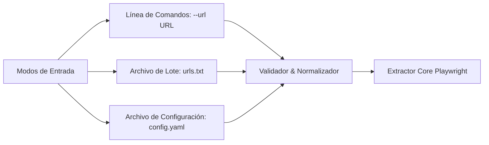
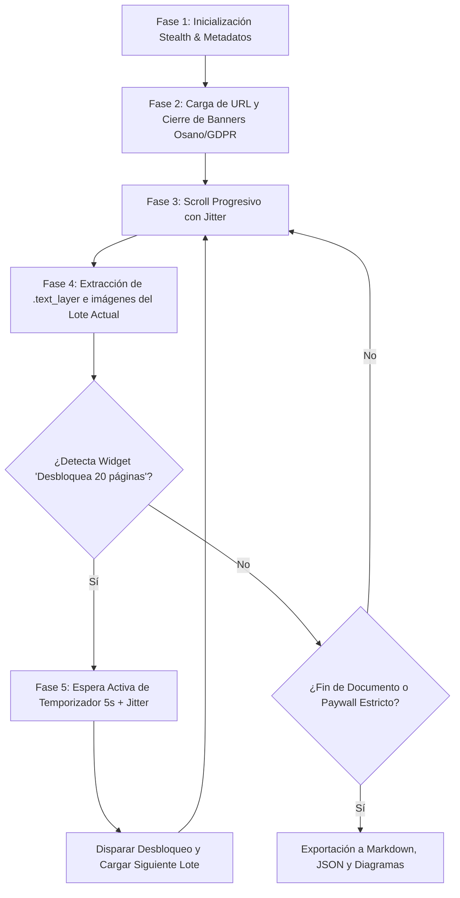

# Plan de Extracción Automatizada Sin Login (Parametrizable)

**Objetivo:** Extracción de contenido y metadatos de documentos en Scribd sin requerir autenticación ni credenciales, con soporte para cualquier URL parametrizable.  
**Stack Principal:** Python 3.10+ | Playwright (Stealth) | BeautifulSoup4 | Pydantic  
**Documento Piloto:** [GoAnywhere MFT User Guide 7.7.0](https://es.scribd.com/document/855660163/ga7-7-0-user-guide)  

---

### 1.1. Realidad Técnica Comprobada: Navegación Completa sin Login
A través de la verificación en la sesión activa del explorador (donde se ha alcanzado la **página 52 y superiores** navegando con los controles de página):
1. **Acceso al 100% del Documento:** Scribd **no restringe la navegación a 10 páginas**. Mediante los controles nativos de avance del visor, cualquier usuario sin cuenta puede recorrer el documento completo (127 páginas en la guía de GoAnywhere).
2. **Mecanismo Primario de Avance:**
   - **Botón de Página Siguiente (Flecha abajo en barra lateral izquierda):** Control `button` accesible que avanza secuencialmente el documento y sincroniza el renderizado de la siguiente página.
   - **Control de Salto a Página (`<input aria-label="Saltar a página" />`):** Permite indicar el número de página deseada para posicionamiento rápido o recuperación de sesión.
3. **Manejo de Intersticiales:** En caso de que se presente alguna ventana intermedia de anuncio, el bot simplemente gestiona el botón **"Omitir anuncio"** o la pausa del temporizador de 5 segundos, reanudando de inmediato el avance.
4. **Persistencia Incremental Inmediata:** Cada página se guarda en disco tan pronto como se extrae su contenido.

### 1.2. Objetivo del Plan
Construir un bot parametrizable que:
* Extraiga el **100% de las páginas del documento** (de la página 1 a la última detectada) de forma secuencial y automatizada.
* Utilice el **botón de página siguiente** y/o **salto directo de página** como motor principal de avance, garantizando que cada página se cargue y se hidrate en el DOM.
* Opere sin credenciales ni login, siendo aplicable a cualquier URL de Scribd mediante parámetros.
* Aplique reglas de seguridad antidetección (delays humanos, emulación de clics reales con jitter, evasión de WAF).

---

## 2. Arquitectura de Parametrización y Flexibilidad

El bot no estará acoplado a una URL fija. Soportará tres mecanismos de entrada:



### 2.1. Normalización de URLs
El sistema aceptará cualquier formato válido de URL de Scribd:
* Formato completo: `https://es.scribd.com/document/855660163/ga7-7-0-user-guide`
* Formato internacional: `https://www.scribd.com/document/855660163/ga7-7-0-user-guide`
* Formato corto/canónico: `https://www.scribd.com/doc/855660163`

El validador extraerá mediante expresiones regulares:
* `document_id`: Identificador numérico único (`855660163`).
* `slug`: Nombre normalizado del documento (`ga7-7-0-user-guide`).

---

## 3. Estrategia de Extracción en 5 Fases (Flujo Ad-Gate)



### Fase 1: Extracción Rápida de Metadatos
Inspección inicial de la cabecera HTML y esquemas JSON-LD (`<script type="application/ld+json">`):
* Título, autor, fecha, categorías, páginas totales reportadas (ej. 127 páginas).

### Fase 2: Inicialización del Navegador Stealth
Instancia de `Playwright` con `playwright-stealth`:
* `headless=True` con `--disable-blink-features=AutomationControlled`.
* `User-Agent` moderno de Chrome/Windows y resolución de 1920x1080.
* Cierre automático de modales de cookies (Osano CMP / OneTrust) para evitar bloqueos del viewport.

### Fase 3: Avance Activo por Controles de Paginación
El avance por el documento no depende únicamente del scroll pasivo, sino de los controles directos del visor:
1. **Botón de Página Siguiente:** Clic automatizado en el control lateral de siguiente página (`button[aria-label*="siguiente"]` / `.IconButtonBase-module_large_hJBmho`).
2. **Input de Salto a Página:** Uso de `<input aria-label="Saltar a página" />` para sincronizar o recuperar la posición exacta del documento.
3. **Emulación de Teclado:** Disparo de pulsaciones `PageDown` para garantizar que el motor de renderizado de Scribd actualice el número de página activa.
4. **Delays Humanos:** Pausas de $1.2s - 2.8s$ con jitter entre cada cambio de página para dar tiempo a la inyección de los elementos en el DOM.

### Fase 4: Extracción de Capa de Texto y Gráficos
Por cada página alcanzada:
1. **Capa de Texto (`.text_layer`):** Se capturan los spans y coordenadas espaciales (`top`, `left`), reconstruyendo el texto en orden natural.
2. **Capa de Imágenes (`.image_layer`):** Se registran y descargan las imágenes vectoriales y capturas (`img.absimg`).
3. **Persistencia Inmediata:** Se guarda el resultado de la página en disco antes de avanzar a la siguiente.

### Fase 5: Gestión de Anuncios Intermedios (Botón 'Omitir anuncio' / Temporizador)
1. **Detección del Intersticial:** Si se detecta un anuncio o widget publicitario bloqueando el visor:
2. **Botón 'Omitir anuncio':** Si aparece el botón interactivo de omisión, el bot hace clic en él tras una pausa humana de $1.5s$.
3. **Temporizador de Anuncio:** Si se presenta la cuenta atrás (5s), se espera su finalización con jitter aleatorio ($+1.0s$).
4. **Reanudación Automática:** Se confirma la desaparición del anuncio y se retoma el avance de páginas mediante el botón de siguiente página.

---

## 4. Reglas de Seguridad Antidetección (Protección contra Bloqueos de IP)

Al no haber inicio de sesión, el único vector de identificación que tiene Scribd es la **dirección IP**, la **huella digital del cliente** y el **patrón de peticiones**. Se implementan las siguientes salvaguardas:

```
[Regla 1: Delays Dinámicos] ----> Nunca usar tiempos fijos (Pausas aleatorias uniformes 1.5s - 3.5s)
[Regla 2: Emulación de Ratón] --> Micro-movimientos y scroll por rueda antes de cada lectura
[Regla 3: Headers Consistentes]-> Enviar Sec-Ch-Ua, Sec-Fetch-* y Accept-Language
[Regla 4: Cool-Down Entre URLs]-> Si se procesa un lote, esperar entre 8s y 15s entre documentos
[Regla 5: Exponential Backoff] -> En caso de HTTP 429/403, duplicar tiempo de espera y abortar si persiste
```

---

## 5. Estructura de Salida Parametrizada

Cada documento extraído se almacena de forma independiente bajo una carpeta con su ID y slug:

```
c:\IA_Proyectos\botScribd\output\
└── 855660163_ga7-7-0-user-guide\
    ├── metadata.json           # Datos globales (título, autor, total páginas vs extraídas)
    ├── contenido.md            # Documento Markdown formateado con el texto extraído
    ├── paginas_raw.json        # Texto indexado página por página
    └── imagenes/               # Diagramas e imágenes descargadas de las páginas públicas
        ├── pag_1_img_1.png
        └── pag_2_img_1.png
```

### Ejemplo del archivo `metadata.json` generado:
```json
{
  "document_id": "855660163",
  "url": "https://es.scribd.com/document/855660163/ga7-7-0-user-guide",
  "titulo": "GoAnywhere MFT User Guide 7.7.0",
  "autor": "krishnaghanat",
  "paginas_totales_declaradas": 140,
  "paginas_extraidas_publicas": 8,
  "estado_paywall": "Bloqueado a partir de la página 9",
  "fecha_extraccion": "2026-10-15T12:00:00Z"
}
```

---

## 6. Plan de Implementación Paso a Paso

| Paso | Actividad | Archivos Involucrados |
| :--- | :--- | :--- |
| **Paso 1** | Definición de entorno y dependencias (`playwright`, `playwright-stealth`, `beautifulsoup4`, `rich`). | `requirements.txt` |
| **Paso 2** | Creación del módulo de configuración y parseo de argumentos CLI (`--url`, `--output-dir`, `--batch-file`). | `config.py` |
| **Paso 3** | Desarrollo del motor de navegación stealth con Playwright y gestión de consentimientos. | `core/browser.py` |
| **Paso 4** | Desarrollo del extractor de `.text_layer`, imágenes y gestor de desbloqueo Ad-Gate (anuncios y temporizadores). | `core/extractor.py` y `core/ad_gate.py` |
| **Paso 5** | Desarrollo del ensamblador y exportador a Markdown/JSON. | `core/exporter.py` |
| **Paso 6** | Script principal orquestador y pruebas con la URL objetivo. | `main.py` |
