# Plan de Trabajo: Construcción del Bot de Extracción en Scribd

**Proyecto:** Bot de Extracción y Reconstrucción de Documentos Scribd (100% Sin Login)  
**Lenguaje:** Python 3.10+  
**Salida Principal:** PDF 1:1 de Alta Resolución (con imágenes originales y texto seleccionable) + Markdown Enriquecido  
**Control de Versiones:** Git (un commit semántico por cada punto/fase del plan)  
**Fecha:** Octubre 2026  

---

## 1. Visión General del Proyecto y Objetivos

Construir un bot modular, parametrizable y resiliente en Python para extraer documentos completos de Scribd sin necesidad de credenciales ni inicio de sesión, preservando la totalidad de diagramas, tablas y capturas de pantalla de manuales técnicos (como *GoAnywhere MFT 7.7.0*).

### Estándar de Versionado Git (Conventional Commits)
Cada fase del plan se registrará en el repositorio mediante un commit semántico que garantiza trazabilidad e historial limpio:
* `feat(setup): ...` Configuración, dependencias y módulo de configuración.
* `feat(browser): ...` Motor de navegación stealth y evasión de WAF.
* `feat(navigator): ...` Controlador de paginación y manejo de Ad-Gates.
* `feat(extractor): ...` Extractor de texto e imágenes de alta resolución.
* `feat(exporter): ...` Compilador de PDF 1:1 y exportador a Markdown.
* `feat(core): ...` Orquestador CLI con interfaz enriquecida y pruebas.

---

## 2. Cronograma de Fases y Puntos de Trabajo

```mermaid
gantt
    title Plan de Construcción del Bot Scribd
    dateFormat  X
    axisFormat %s
    section Fase 1: Base
    Punto 1 - Entorno y Configuración CLI        :active, p1, 0, 1
    section Fase 2: Navegador
    Punto 2 - Motor Playwright Stealth          :p2, 1, 2
    section Fase 3: Paginación
    Punto 3 - Navegación y Ad-Gate               :p3, 2, 3
    section Fase 4: Extracción
    Punto 4 - Extractor Texto e Imágenes         :p4, 3, 4
    section Fase 5: Exportación
    Punto 5 - Compilador PDF 1:1 y Markdown      :p5, 4, 5
    section Fase 6: Orquestación
    Punto 6 - Main CLI y Pruebas en Vivo         :p6, 5, 6
```

---

### Punto 1: Configuración Inicial del Entorno y Arquitectura Base
* **Objetivo:** Establecer la base del proyecto, control de versiones, dependencias y módulo de configuración por CLI.
* **Tareas Específicas:**
  1. Inicializar repositorio Git y archivo `.gitignore` optimizado para Python/Playwright.
  2. Crear archivo de dependencias `requirements.txt`:
     - `playwright`, `playwright-stealth`, `beautifulsoup4`, `lxml`, `requests`, `PyMuPDF` (`fitz`), `Pillow`, `rich`, `pydantic`.
  3. Crear módulo `config.py` con soporte para:
     - Argumentos de línea de comandos (`--url`, `--batch`, `--output-dir`, `--headless`, `--timeout`).
     - Normalizador de URLs de Scribd y extractor de ID numérico (`document_id`) y título (`slug`).
     - Configuración de tiempos de espera con *jitter* (1.5s - 3.5s).
* **Entregables:** `.gitignore`, `requirements.txt`, `config.py`.
* **Commit Git:** `feat(setup): inicializar entorno, dependencias y configuracion cli`

---

### Punto 2: Motor de Navegación Stealth y Evasión WAF
* **Objetivo:** Inicializar una instancia controlada de Chromium que oculte cualquier firma de automatización WebDriver frente a Cloudflare y Scribd.
* **Tareas Específicas:**
  1. Crear `core/browser.py`:
     - Lanzamiento de Chromium con flags `--disable-blink-features=AutomationControlled`.
     - Inyección de perfiles stealth (`playwright-stealth`) para enmascarar `navigator.webdriver`, plugins y WebGL.
     - Configuración de viewport de escritorio (1920x1080), idioma `es-ES` y cabeceras completas de cliente moderno.
  2. Implementar gestor automático de banners de privacidad y cookies (Osano CMP / OneTrust) para evitar bloqueos del viewport.
* **Entregables:** `core/browser.py`.
* **Commit Git:** `feat(browser): implementar navegador stealth y gestion de consentimientos`

---

### Punto 3: Controlador de Paginación y Evasión Ad-Gate
* **Objetivo:** Garantizar el avance secuencial a lo largo del 100% de las páginas del documento sin interrupciones publicitarias.
* **Tareas Específicas:**
  1. Crear `core/navigator.py`:
     - Avance automatizado utilizando el botón de página siguiente (`button[aria-label*="siguiente"]` / `.IconButtonBase-module_large_hJBmho`).
     - Soporte para salto directo de página mediante el input `<input aria-label="Saltar a página" />`.
     - Emulación de teclado (`PageDown`) y micro-scrolls para sincronizar el renderizado del visor.
  2. Crear `core/ad_gate.py`:
     - Detector en tiempo real del componente intersticial ("Desbloquea las próximas 20 páginas después de un anuncio").
     - Detección y clic automático en el botón **"Omitir anuncio"**.
     - Espera controlada con jitter si el anuncio impone temporizador de cuenta atrás (5 segundos).
     - Verificación del desbloqueo exitoso antes de reanudar la extracción.
* **Entregables:** `core/navigator.py`, `core/ad_gate.py`.
* **Commit Git:** `feat(navigator): anadir avance continuo de paginas y gestion de ad-gate`

---

### Punto 4: Extractor de Capas de Contenido e Imágenes de Alta Resolución
* **Objetivo:** Extraer la información íntegra de cada página del visor sin pérdida de datos.
* **Tareas Específicas:**
  1. Crear `core/extractor.py`:
     - Parseo de `.text_layer`: lectura de spans con coordenadas CSS (`left`, `top`, `font-size`) y ordenamiento natural para reconstruir párrafos y encabezados limpios.
     - Parseo de `.image_layer`: obtención de URLs CDN directas de las imágenes de alta resolución (`img.absimg` en formatos WebP/PNG).
     - Descarga asíncrona de imágenes de cada página en `output/{doc_id}/imagenes/`.
     - Mecanismo de persistencia incremental (*flush* inmediato a disco por cada página extraída).
* **Entregables:** `core/extractor.py`.
* **Commit Git:** `feat(extractor): implementar extraccion de capas de texto e imagenes cdn`

---

### Punto 5: Ensamblador Dual (PDF Searchable 1:1 + Markdown Enriquecido)
* **Objetivo:** Consolidar el material extraído en los formatos de mayor utilidad y fidelidad técnica.
* **Tareas Específicas:**
  1. Crear `core/pdf_builder.py`:
     - Ensamblaje secuencial de todas las imágenes de alta resolución en un único PDF consolidado de alta calidad mediante `PyMuPDF` (`fitz`) o `Pillow`.
     - Inyección de la capa de texto invisible sobre cada página para que el PDF sea 100% interactivo, seleccionable y con búsqueda interna de texto.
  2. Crear `core/exporter.py`:
     - Generación de `metadata.json` con estadísticas del documento.
     - Generación de `contenido.md` con el texto estructurado y las referencias directas a las imágenes de cada sección (``).
* **Entregables:** `core/pdf_builder.py`, `core/exporter.py`.
* **Commit Git:** `feat(exporter): implementar generacion dual de pdf 1a1 y markdown con imagenes`

---

### Punto 6: Orquestador Principal, CLI y Pruebas en Vivo
* **Objetivo:** Integrar todos los módulos en una herramienta de línea de comandos intuitiva con retroalimentación visual rica y verificar su funcionamiento real.
* **Tareas Específicas:**
  1. Crear `main.py`:
     - Orquestador con barra de progreso y métricas en tiempo real utilizando la librería `rich`.
     - Manejo de señales de interrupción (`Ctrl+C`) guardando el estado parcial alcanzado.
     - Soporte para procesar una URL individual o un archivo de URLs en lote (`urls.txt`).
  2. Ejecutar prueba integral con el documento piloto:
     `https://es.scribd.com/document/855660163/ga7-7-0-user-guide`
* **Entregables:** `main.py`, `README.md`.
* **Commit Git:** `feat(core): orquestador principal y validacion de ejecucion completa`

---

## 3. Matriz de Entregables y Versionado Git

| Punto | Componente / Archivos | Descripción del Commit |
| :---: | :--- | :--- |
| **0** | `.gitignore`, Documentación previa | `docs: agregar informe tecnico, plan de extraccion y plan de trabajo` |
| **1** | `requirements.txt`, `config.py` | `feat(setup): inicializar entorno, dependencias y configuracion cli` |
| **2** | `core/browser.py` | `feat(browser): implementar navegador stealth y gestion de consentimientos` |
| **3** | `core/navigator.py`, `core/ad_gate.py` | `feat(navigator): anadir avance continuo de paginas y gestion de ad-gate` |
| **4** | `core/extractor.py` | `feat(extractor): implementar extraccion de capas de texto e imagenes cdn` |
| **5** | `core/pdf_builder.py`, `core/exporter.py` | `feat(exporter): implementar generacion dual de pdf 1a1 y markdown con imagenes` |
| **6** | `main.py`, `README.md` | `feat(core): orquestador principal y validacion de ejecucion completa` |
