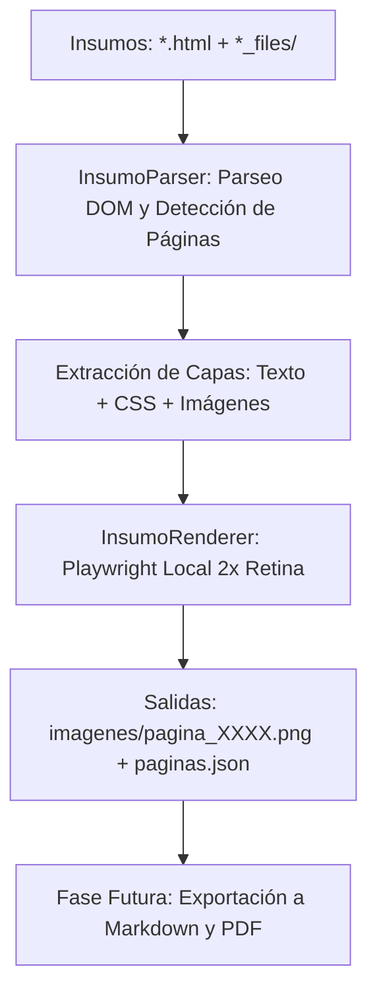

# PLAN DE TRABAJO: REFRACTORIZACIÓN INTEGRAL A BOT DE EXTRACCIÓN OFFLINE (INSUMO)

## 1. Justificación y Cambio de Paradigma

El modelo anterior basado en navegación web en vivo (*live web scraping*) presentaba múltiples fragilidades:
- Bloqueos intermitentes por muros publicitarios (*ad gates*) con temporizadores de 15 segundos.
- Descarga asíncrona perezosa (*lazy loading*) dependiente del viewport y eventos complejos del navegador.
- Dependencia de la conexión a internet, variaciones en CDN y detección antibot.

**Nuevo Paradigma:**
El bot pasará a ser una **herramienta de procesamiento offline de alta fidelidad**. Tomará como entrada los archivos HTML guardados directamente en la carpeta [insumo/](file:///c:/IA_Proyectos/botScribd/insumo) (junto con su carpeta complementaria `_files/`), extraerá las capas vectoriales, tipográficas e imágenes locales, y reconstruirá cada página en resolución Retina 2x (PNG) con su correspondiente metadata en `paginas.json`.

---

## 2. Alcance y Fases de Trabajo

### Fase 1: Limpieza Arquitectónica y Configuración
- **Objetivo:** Desacoplar el bot de la navegación en vivo y actualizar la configuración.
- **Acciones:**
  1. Deprecar/eliminar dependencias de navegación web interactiva (`core/ad_gate.py`, `core/navigator.py`).
  2. Simplificar `config.py` eliminando URLs remotas, credenciales web y timeouts de red.
  3. Establecer parámetros enfocados en insumos: ruta de carpeta de insumos, resolución de renderizado (`device_scale_factor = 2.0`), directorio de salida y límite de páginas opcional.
- **Entregables:** `config.py` actualizado, commits convencionales `refactor(config): adaptar parametros para procesamiento offline de insumos`.

---

### Fase 2: Motor de Parseo de Insumos (`core/insumo_parser.py`)
- **Objetivo:** Analizar el DOM del archivo HTML guardado, extraer estilos globales y aislar cada página del documento.
- **Acciones:**
  1. Escaneo automático de la carpeta `insumo/` para detectar archivos `.html` y sus carpetas asociadas `_files/`.
  2. Extracción de metadatos del documento (título, autor, hash, conteo total de páginas).
  3. Filtrado de páginas pobladas: identificar qué contenedores `.outer_page` poseen estructura `.newpage`, capas `.text_layer` e imágenes incrustadas.
  4. Extracción de texto estructurado por página (párrafos, spans y posiciones) para generar `paginas.json`.
  5. Resolución de rutas locales: transformar enlaces relativos o referencias a CDN para que apunten directamente a los archivos locales existentes en `_files/` (ej. `1-15a6bc3f13.jpg`, `fonts.css`).
- **Entregables:** Módulo `core/insumo_parser.py` con pruebas unitarias/de verificación.

---

### Fase 3: Renderizador Offline de Páginas (`core/insumo_renderer.py`)
- **Objetivo:** Reconstruir visualmente cada página con fidelidad 1:1 respecto a Scribd original en formato PNG Retina 2x.
- **Acciones:**
  1. Compilar el conjunto de reglas CSS requeridas:
     - Fuentes tipográficas (`ff0` a `ff7`, declaradas en `fonts.css`).
     - Clases de microespaciado (`span.l1-l12`, `span.w1-w12`).
     - Transformación tipográfica exacta (`.text_layer { transform: scale(0.2); transform-origin: top left; }`).
     - Soporte para sprites con recorte `clip: rect(...)`.
  2. Implementar `InsumoRenderer` con Playwright en modo headless ultra-ligero (`set_content` con `base_url` local), sin llamadas de red externas.
  3. Renderizado secuencial de cada página aislada (`.newpage`) directamente al elemento DOM específico.
  4. Guardado en `output/<slug_documento>/imagenes/pagina_XXXX.png` a escala 2.0x nítida.
- **Entregables:** Módulo `core/insumo_renderer.py` optimizado y validado.

---

### Fase 4: Orquestación y Línea de Comandos (`main.py`)
- **Objetivo:** Proveer una experiencia CLI robusta, clara e intuitiva con reportes en tiempo real.
- **Acciones:**
  1. Refactorizar el CLI con `argparse`:
     - `--insumo`: Ruta opcional al archivo o carpeta HTML (por defecto `insumo/`).
     - `--max-pages`: Límite opcional de páginas a procesar (para pruebas controladas).
     - `--output`: Directorio de destino.
  2. Integración de interfaz Rich (barras de progreso, tabla resumen de páginas generadas, dimensiones y tiempos de procesamiento).
  3. Generación y almacenamiento del archivo `paginas.json` con la metadata de cada página procesada (número, ruta de imagen, dimensiones, texto extraído).
- **Entregables:** `main.py` refactorizado y operativo.

---

### Fase 5: Validación Integral y Pruebas
- **Objetivo:** Comprobar la extracción y renderizado completo sobre los insumos disponibles.
- **Acciones:**
  1. Ejecución del bot sobre el insumo actual (`GoAnywhere MFT User Guide 7.7.0...html`).
  2. Verificación de que las páginas generadas posean imágenes integradas, texto nítido, sin superposiciones ni fallos tipográficos.
  3. Validación de integridad de `paginas.json` y del directorio `output/`.
- **Entregables:** Informe de ejecución y certificación de calidad de imágenes.

---

### Fase 6: Generación de Markdown y PDF (Postergado a Fase Final)
- **Objetivo:** Según requerimiento explícito, la generación de documentos `.md` y `.pdf` se mantiene postergada hasta que la extracción e integración a nivel de imágenes esté 100% validada y aprobada por el usuario.
- **Acciones futuras:**
  - `core/exporter.py`: Ensamblar el Markdown estructurado a partir del texto y las imágenes procesadas.
  - `core/pdf_builder.py`: Compilar el PDF final vectorial o de imágenes optimizadas.

---

## 3. Matriz de Control de Versiones (Git)

Cada fase se versionará de manera individual con Git siguiendo la convención acordada:

| Hito | Tipo | Mensaje de Commit |
| :--- | :--- | :--- |
| **0** | `docs` | `docs: agregar plan de trabajo para bot de extraccion offline desde insumo` |
| **1** | `refactor` | `refactor(config): reestructurar configuracion y remover modulos de navegacion web` |
| **2** | `feat` | `feat(parser): implementar InsumoParser para lectura local de HTML y assets` |
| **3** | `feat` | `feat(renderer): implementar renderizador local Playwright a 2x Retina` |
| **4** | `feat` | `feat(cli): integrar CLI y pipeline principal en main.py para procesamiento offline` |
| **5** | `test` | `test: validar extraccion completa de imagenes y metadatos desde insumo` |
